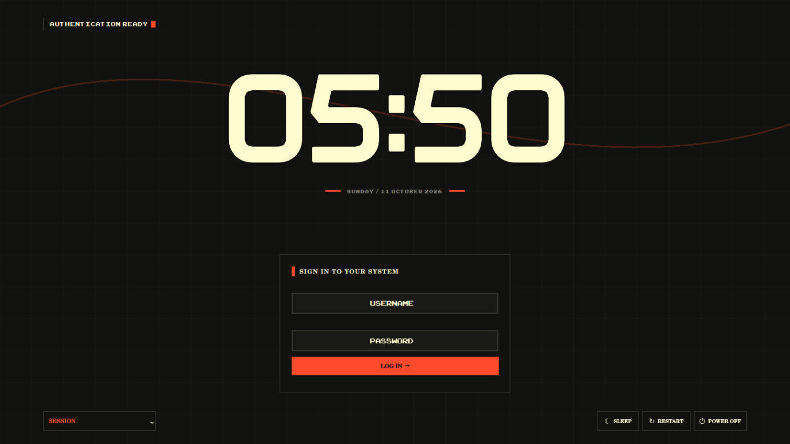

# BRUTAL — SDDM Theme

A bold, minimalist **SDDM login theme** built with Qt Quick and QML. BRUTAL combines neo-brutalist design, sharp edges, high-contrast colors, and oversized typography to give your Linux login screen a distinctive look.

<p align="center">
  <strong>INK. PAPER. RED.</strong>
</p>

 
## ✦ Features

- **Neo-brutalist design** — sharp corners, bold typography, and a clean layout.
- **Minimalist clock** — a prominent digital clock.
- **Login interface** — username and password fields with a focused layout.
- **Session selector** — switch between available desktop sessions.
- **Power controls** — convenient Sleep, Restart, and Power Off options.
- **QML-based** — built with Qt Quick and Qt Quick Shapes.

BRUTAL is designed around contrast, simplicity, and a functional layout rather than decorative effects.

## 📋 Requirements

- Linux with SDDM installed
- Qt 6 and a compatible Qt Quick environment
- Qt Quick Shapes
- A working SDDM greeter environment

The theme is intended for Qt 6-based SDDM setups.

## 📦 Installation

### 1. Download the theme

Download or clone this repository, then extract it if necessary.

### 2. Install the theme

Copy the `BRUTAL-SDDM` theme directory into SDDM's themes directory:

```bash
sudo mkdir -p /usr/share/sddm/themes
sudo cp -r BRUTAL-SDDM /usr/share/sddm/themes/
```

Make sure the resulting structure looks like this:

```text
/usr/share/sddm/themes/BRUTAL-SDDM/
├── Main.qml
├── theme.conf
├── metadata.desktop
├── README.txt
└── assets/
    ├── README.txt
    └── HiJO-Regular.otf
```

### 3. Configure SDDM

Open the SDDM configuration file:

```bash
sudo nano /etc/sddm.conf
```

Set the theme directory under the `[Theme]` section:

```ini
[Theme]
Current=BRUTAL-SDDM
```

If your system uses `/etc/sddm.conf.d/` for configuration, place the setting in an appropriate configuration file there instead.

**Warning:** Changing your SDDM theme affects the graphical login screen. Keep a working fallback theme available in case the greeter fails to load.

##  Preview Without Installing

You can test the theme before making it your system's login screen.

From the extracted theme directory, run:

```bash
sddm-greeter-qt6 --test-mode --theme "$PWD"
```

Or specify the theme directory directly:

```bash
sddm-greeter-qt6 --test-mode \
  --theme "$HOME/BRUTAL-SDDM"
```

The exact command and available Qt plugins may vary depending on your distribution.


### You cannot log in after changing the theme

Switch back to a known-working SDDM theme by editing the SDDM configuration from a TTY or recovery environment.

## 🤝 Contributing

Suggestions, bug reports, and improvements are welcome. If you find a layout issue or a compatibility problem, please include your Linux distribution, Qt version, and relevant greeter logs.


  <em>A sharper welcome to Linux.</em>
</p>
